<!-- ====================== HEADER ====================== -->
<p align="center">
  
</p>

<p align="center">
  <a href="https://git.io/typing-svg">
    
  </a>
</p>

<p align="center">
  <a href="mailto:david24ti@mahasiswa.pcr.ac.id"></a>
  <a href="https://instagram.com/_davidsiagian02"></a>
  <!-- Tambahkan kalau sudah punya:
  <a href="https://linkedin.com/in/USERNAME"></a>
  <a href="https://URL-PORTFOLIO.vercel.app"></a>
  -->
  
</p>

<!-- ====================== ABOUT ====================== -->
## 👨‍💻 About Me

I'm a third-year **Informatics Engineering** student at **Politeknik Caltex Riau** who enjoys turning ideas into things people can actually use, from web apps and Android apps to 3D games. I like working across the whole stack: designing the interface, wiring up the backend and database, and shipping it live.

Right now I'm building a **Mock API Generator** for my final project, a web tool that lets front-end developers design data schemas, spin up mock REST endpoints filled with dummy data, and simulate HTTP status codes without waiting for a real backend.

```javascript
const david = {
  role:       "Informatics Engineering Student",
  campus:     "Politeknik Caltex Riau",
  focus:      ["Web Development", "Mobile Development", "Game Development"],
  exploring:  ["Big Data", "Machine Learning", "GIS"],
  building:   "Mock API Generator (final project)",
  reachMe:    "david24ti@mahasiswa.pcr.ac.id",
};
```

<!-- ====================== PROJECTS ====================== -->
## 🚀 What I've Been Building

| Project | Description | Tech |
| :-- | :-- | :-- |
| **Mock API Generator** 🚧 | Final project. A web-based tool for front-end testing: design data schemas, generate mock REST endpoints with dummy data, and simulate HTTP status codes. | `Web` `REST API` |
| **[Jangkau WebGIS](https://github.com/davidsiagian02/jangkau-webgis)** | Team project. Maps how well schools in Pekanbaru are served by public transport, with bus-stop buffer analysis, out-of-reach schools, and new stop recommendations. | `OpenLayers` `PostgreSQL + PostGIS` `Vercel` |
| **MyLyrics** | Scrolling-lyrics studio for creating 9:16 lyric videos, available as a website and as a redesigned Android app. | `HTML` `CSS` `JavaScript` `Android` |
| **VidzFun** | All-in-one Discord bot: music player, fun commands, moderation tools, giveaways, and polls. | `JavaScript` `Node.js` |
| **Offroad Expedition Simulator** 🚧 | 3D off-road 4x4 exploration and expedition game for Android, in a stylized low-poly art style. | `Unity (URP)` `C#` |
| **Forgebound** | Roblox crafting tycoon with idle and auto-battle mechanics, built around forging swords. | `Roblox Studio` `Luau` |
| **JTI PCR Radio** | Campus internet radio: a live streaming server plus a website for listeners. | `Mixxx` `Icecast2` `PHP` `Linux` |

<!-- ====================== TECH STACK ====================== -->
## 🛠️ Tech Stack

<table>
  <tr>
    <td align="center" width="150"><b>Languages</b></td>
    <td></td>
  </tr>
  <tr>
    <td align="center"><b>Frameworks</b></td>
    <td></td>
  </tr>
  <tr>
    <td align="center"><b>Mobile &amp; Game</b></td>
    <td></td>
  </tr>
  <tr>
    <td align="center"><b>Data</b></td>
    <td></td>
  </tr>
  <tr>
    <td align="center"><b>Tools &amp; Cloud</b></td>
    <td></td>
  </tr>
</table>

<!-- ====================== STATS ====================== -->
## 📊 GitHub Stats

<!-- stats.svg & top-langs.svg dibuat otomatis oleh .github/workflows/profile-cards.yml -->
<p align="center">
  
  
</p>

<p align="center">
  
</p>

<p align="center">
  
</p>

<p align="center">
  <picture>
    <source media="(prefers-color-scheme: dark)" srcset="./profile/snake-dark.svg" />
    <source media="(prefers-color-scheme: light)" srcset="./profile/snake.svg" />
    
  </picture>
</p>

<!-- ====================== FOOTER ====================== -->
<p align="center">
  
</p>
